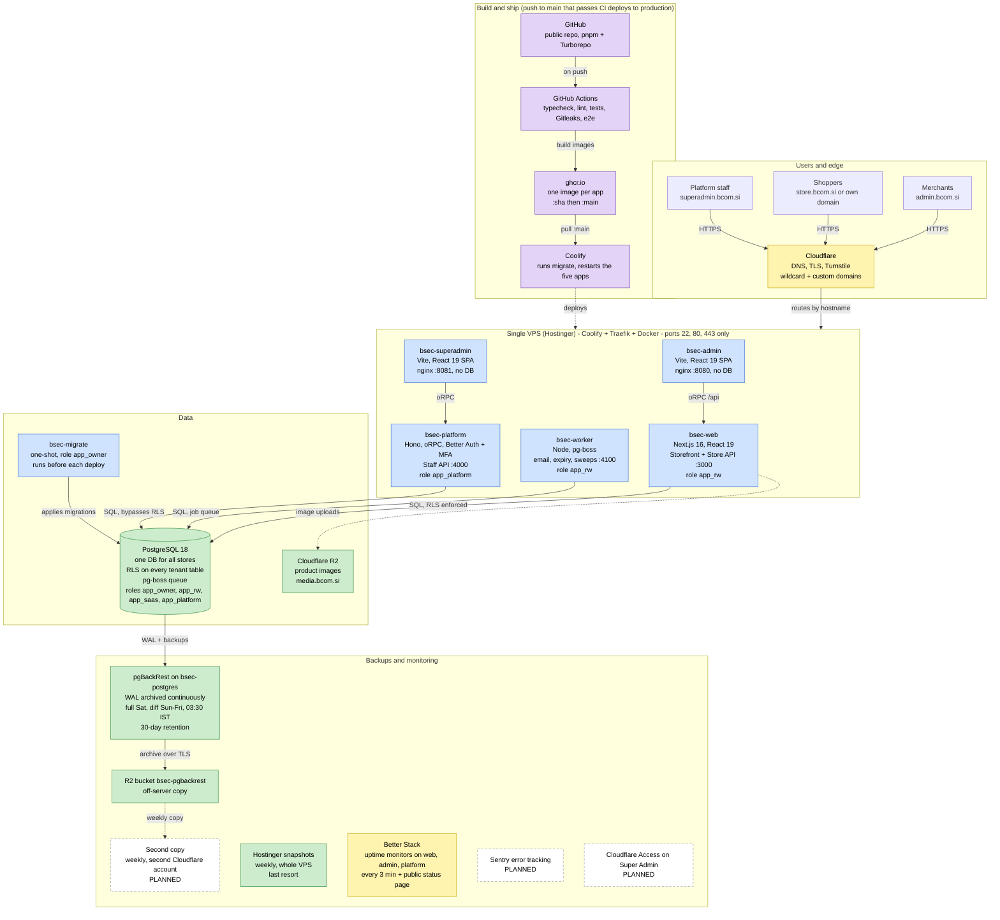

# bsec system diagram

A one-page picture of the whole platform: who uses it, what runs where, which languages and tools, backups, monitoring and the deploy pipeline. It is the visual companion to [`ARCHITECTURE.md`](ARCHITECTURE.md), which stays the source of truth. If the two disagree, the code wins, then `ARCHITECTURE.md`, then this file.

| Copy | What it is | Use it for |
|---|---|---|
| **This file** (Mermaid below) | Text diagram, renders on GitHub and in most editors, diffs cleanly | Quick local reference, review in pull requests |
| [`diagrams/system-board.json`](diagrams/system-board.json) | Snapshot of the whiteboard (every box, arrow and label) | Offline record, restoring the board if it is lost |
| Whiteboard artifact (live) | The styled, editable board, created 2026-11-25 in the Claude app | Presenting, walking someone through the system |

Whiteboard: <https://claude.ai/artifact/PTbu9tSNxj4wdN2UizABbJ> (private to its owner until shared).

Colour key: edge and outside watchers, services, data and backups, build and ship. Dashed boxes are planned or not live yet.

## Languages and tools

| Layer | What we use |
|---|---|
| Language | TypeScript 6 (strict) end to end, SQL migrations |
| Frontend | React 19, Next.js 16 (Cache Components), Vite, TanStack Router, Tailwind, shadcn on Base UI, Puck page editor |
| Backend | Hono, oRPC with Zod contracts, Better Auth, Drizzle ORM, pg-boss queues; all business logic in `packages/domain` |
| Data | PostgreSQL 18 with row-level security, Cloudflare R2 for media |
| Tooling | Node 24, pnpm 10, Turborepo, Vitest, Playwright, ESLint 10, Docker, k6 load tests |
| Payments | COD live; Razorpay per store; Stripe and PayPal for other markets. Shiprocket and email delivery not live yet |

## Keeping it current

Update this diagram **in the same change** whenever you:

- add, remove or rename a deployed service or change a port or DB role,
- add a data store, bucket, queue provider or external service (monitoring, error tracking, email, payments, CDN),
- change the backup schedule, retention, destination or recovery path,
- change the CI/CD pipeline stages or the deploy target,
- move something from planned to live (drop the dashed style and the "planned" word).

How, in order:

1. Edit the Mermaid block above (this is the reviewed copy).
2. Update the whiteboard to match (Claude can do this: ask it to "update the system board from `docs/SYSTEM-DIAGRAM.md`").
3. Refresh the snapshot: ask Claude to re-export the board to `docs/diagrams/system-board.json`, and bump the date in its `exported` field.
4. Update the matching section of `ARCHITECTURE.md` (section 2 and 4 for topology, 3 for apps and packages) and mention the diagram in your change record.

Never put secrets, server IPs or credentials on the diagram or in the snapshot (AGENTS.md section 5: the repository is public).

Last updated: 2026-11-25 (initial version, matches `ARCHITECTURE.md` as verified at `main` ce06cbf plus the backup and monitoring state of 2026-11-25).
